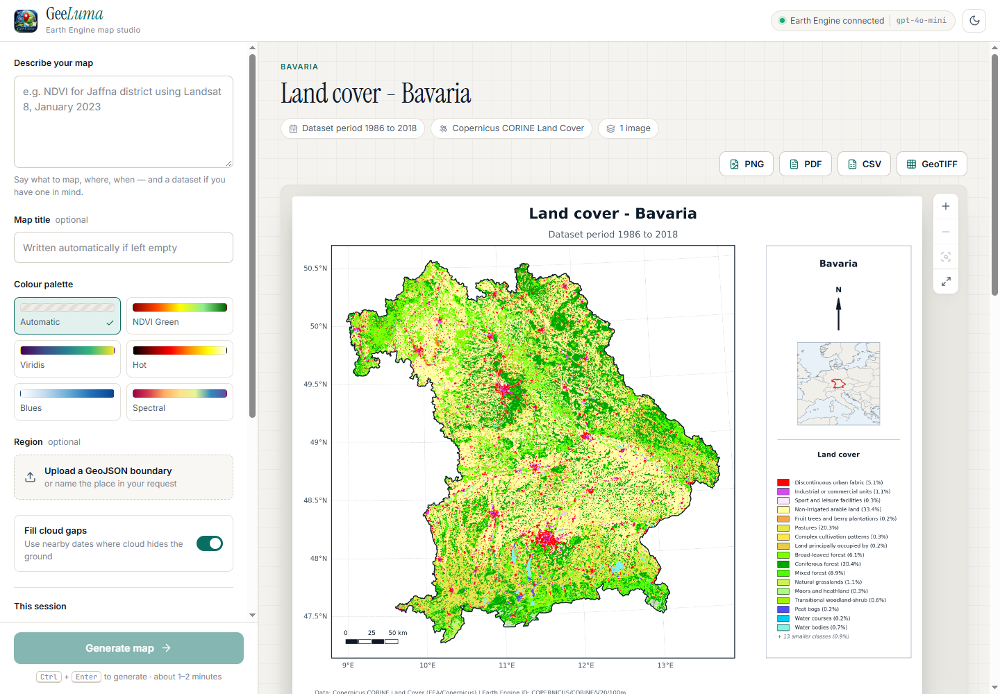

# Gee-Luma — GEE Map Studio

Describe a map in plain English; Gee-Luma finds the dataset in Google Earth Engine,
processes it, and returns a print-ready cartographic map.

Built with React, Starlette, CrewAI, Earth Engine and spyndex. A Streamlit version of the
interface is included as well; both use the same pipeline.



## How it works

1. **Agent** (CrewAI + GPT-4o-mini) reads the request and chooses the dataset, band,
   region, period and compositing method. It searches the live Earth Engine catalog
   and checks the dataset's real bands before answering.
2. **Dataset metadata** is read from the public Earth Engine STAC catalog: scale and
   offset, units, class names and colours, coverage period, provider. This is what
   lets the app map datasets it has no built-in knowledge of.
3. **Region** is resolved from geoBoundaries (any country, province/state or district),
   from an uploaded GeoJSON, or — for areas that are not administrative units — from
   an approximate bounding box.
4. **Processing** runs on Earth Engine: cloud masking, compositing over the period,
   index computation, scaling to real units.
5. **Rendering** fetches the result at print resolution in a projection suited to the
   region and lays out the final map.

## Project structure

```
Gee-Luma/
├── server.py                # Start here: web API + host of the React interface
├── app.py                   # Streamlit interface (alternative to the web one)
├── requirements.txt
├── .env.example             # Copy to .env and add your OpenAI key
├── frontend/                # React interface (Vite + TypeScript)
├── assets/                  # Logo
├── docs/                    # Screenshots
└── gee_luma/                # The map pipeline (Python package)
    ├── pipeline.py          # The whole pipeline, independent of any interface
    ├── catalog_search.py    # Live Earth Engine catalog search (agent tool)
    ├── stac_metadata.py     # Per-dataset metadata from the EE STAC catalog (agent tool)
    ├── knowledge_base.md    # Reference notes given to the agent
    ├── boundary_agent.py    # Place name -> admin boundary (geoBoundaries, any country)
    ├── geojson_helpers.py   # Uploaded GeoJSON: reprojection + ee.Geometry conversion
    ├── dataset_config.py    # Sensor band maps, class schemas, colour-range statistics
    ├── cloud_masking.py     # Per-sensor cloud/shadow masking (Cloud Score+, QA bands)
    ├── map_engine.py        # Index computation (spyndex) and composite map types
    ├── palettes.py          # Colour palettes per index and theme
    ├── class_legend.py      # Class legends for classified bands of any dataset
    ├── projection.py        # Chooses a map projection for the region
    ├── thumbnail.py         # Tiled, parallel high-resolution image fetch
    ├── time_series.py       # Splits a period into the maps of a multi-map figure
    ├── cartography.py       # Final map layout, single and multi-map (PNG and PDF)
    ├── map_stats.py         # Region statistics and CSV export
    ├── exports.py           # GeoTIFF export of the data values
    ├── styles.py            # CSS and header HTML for the Streamlit page
    └── utils.py             # Shared helpers
```

## Quick start

```bash
git clone https://github.com/suvasthigha-puvan/Gee-Luma.git
cd Gee-Luma

python -m venv .venv
source .venv/bin/activate  # Windows: .venv\Scripts\activate
pip install -r requirements.txt

earthengine authenticate
cp .env.example .env       # then put your OpenAI key in it

# Build the web interface once (needs Node.js 18+)
cd frontend
npm install
npm run build
cd ..

# Start Gee-Luma
python server.py            # http://localhost:8000
```

The Streamlit interface still works: `streamlit run app.py`.

Set `EE_PROJECT` to your own Earth Engine project ID (the default is in `gee_luma/pipeline.py`).

### Working on the interface

Run the API and the interface's dev server side by side; the dev server reloads on
every change and forwards `/api` calls to the Python server:

```bash
python server.py            # terminal 1
cd frontend && npm run dev  # terminal 2 -> http://localhost:5173
```

Run `npm run build` again to update what `server.py` serves.

## The web interface

- Compose on the left: request, optional title, palette, region upload, gap-fill switch
- Live progress while the map is generated, step by step
- Map viewer with zoom and pan, gap-filled / original switch, and PNG, PDF, CSV and
  GeoTIFF downloads
- Statistics with a histogram or class-area bars, plus source and method details
- Light and dark themes; the open map stays in the address bar (`?map=...`), so a
  refresh returns to it
- Maps are kept in the server's memory for the session only

## What you can ask for

- **Any image dataset in the Earth Engine catalog** — name it, or describe the theme
  and the standard global dataset is used (ESA WorldCover for land cover, SRTM for
  elevation, CHIRPS for rainfall, and so on)
- **200+ spectral indices** via spyndex (NDVI, kNDVI, EVI, NBR, MNDWI, …)
- **Colour composites**: true colour, false colour, SWIR, Sentinel-1 radar
- **Categorical products**: land cover and any other classified band, with the
  dataset's own class names and colours
- **Totals and averages** over a period (e.g. total rainfall for a year)
- **Several maps in one figure** — a map per month, season or year, a multi-year
  climatology, or named periods side by side (see below)
- **Any region**: a country, province/state or district anywhere; an uploaded GeoJSON
  (any CRS); or a larger area such as a continent

Vector (table) datasets are not supported yet.

## Several maps in one figure

Ask for more than one period and the maps are drawn together, on one page:

| Request                                              | Figure                                                        |
|------------------------------------------------------|---------------------------------------------------------------|
| "Monthly ET maps of Sri Lanka for 2025"              | 12 maps, each the total of one month                          |
| "Monthly average land surface temperature, 2024"     | 12 maps, each the mean of one month                           |
| "Seasonal NDVI of Nepal for 2024"                    | 4 maps: Dec–Feb, Mar–May, Jun–Aug, Sep–Nov                    |
| "Annual rainfall maps of Kenya, 2015 to 2024"        | 10 maps, each the total of one year                           |
| "Average monthly rainfall of India, 2001–2020"       | 12 maps: each calendar month's total, averaged over 20 years  |
| "NDVI of Punjab in July 2015 vs July 2025"           | 2 maps, the periods named                                     |

- **What each map holds** follows the request and the variable: a *total* per period for
  rainfall and evapotranspiration, a *mean* when an average is asked for, a median for
  reflectance and indices, the most common class for classified data. A climatology of
  totals is the average of each year's total, not one total over all the years. The
  title, legend and credit block say which it is.
- **The grid** is chosen from the shape of the region so the maps are drawn as large
  as the page allows: twelve maps of a tall region become 6 × 2, of a wide region
  3 × 4, of a compact one 4 × 3.
- **Comparable by construction**: every map has the same extent, projection and colour
  scale (fitted to all of them together), under one shared legend and scale bar.
- Whole calendar units are mapped: a period that covers less than half of a month,
  season or year does not get a map of it. A period still running ends today, and
  periods with no images are left out; both are reported.
- Cloud gaps are not filled in a series (each map shows its own period only), and a
  figure holds at most 36 maps.
- Statistics are given per map, the CSV has a row per map, and the GeoTIFF has one
  band per map.

A request for a single period still produces the single-map layout described next.

## The map

- Projection chosen per region: local UTM zone, or Lambert equal-area for wide regions
- Rendered at about 2,000 px on the long side, exported at 300 dpi
- Cloud masking applied by default for Sentinel-2 (Cloud Score+), Landsat, MODIS and
  VIIRS surface reflectance; add "keep clouds" to a request to turn it off
- Cloud gaps filled from nearby dates: when less than 97% of the region has data in
  the requested period, the gaps are filled with imagery from the weeks before and
  after it (nearest first, up to three widening steps). The map and its credit block
  say so, and the original unfilled map is available in a second tab. Turn it off with
  the sidebar switch or by adding "no gap fill" to the request. Totals (sums) are
  never filled.
- Graticule, true-length scale bar, north arrow, locator map
- Legend in real units, with the colour range fitted to the data in the region
- Class legends for every classified band, whatever the dataset publishes: the
  catalog's own class names and colours where it lists them; distinct colours assigned
  where it lists names only; names read from the band description where classes are
  only written out there; and classes labelled by value where nothing is published
  (the band is recognised as classified from its data). Only classes present in the
  region are listed, long legends show the largest classes and sum up the rest, and
  "only" in a request ("crop class only") maps just those classes.
- Credit block: dataset title and provider, Earth Engine ID, period, compositing
  method, cloud masking, projection, native resolution, production date
- Optional custom title

## Statistics and exports

- **Statistics over the region**, computed from the same image that is drawn:
  mean, median, min, max, standard deviation, percentiles and a histogram for
  continuous maps; area and share per class for categorical maps. Shown in the app
  and summarised on the map itself.
- **PNG** (300 dpi) and **PDF** (vector text and lines) of the map layout
- **CSV** of the statistics
- **GeoTIFF** of the data values (real units or class codes) in the map projection.
  Earth Engine caps direct downloads at about 48 MB, so large regions are exported
  at a coarser pixel size than the dataset's native one; the app states the size used.

## Environment variables

| Variable         | Description                                             |
|------------------|---------------------------------------------------------|
| `OPENAI_API_KEY` | Required for the CrewAI agent                           |
| `EE_PROJECT`     | Earth Engine project ID (optional)                      |
| `GEE_LUMA_MODEL` | Agent model, default `openai/gpt-4o-mini` (optional)    |
| `PORT`           | Port for `server.py`, default 8000 (optional)           |

## License

MIT
